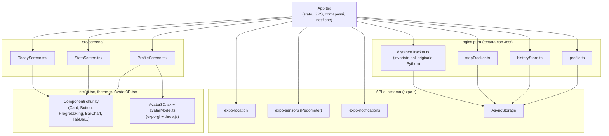
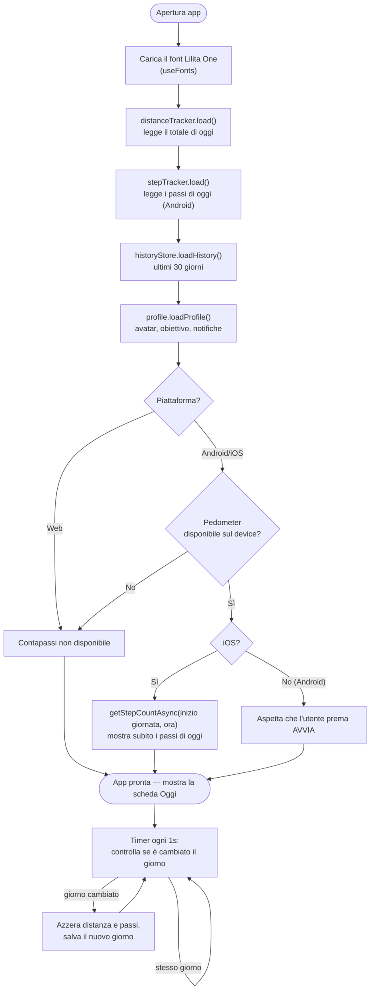
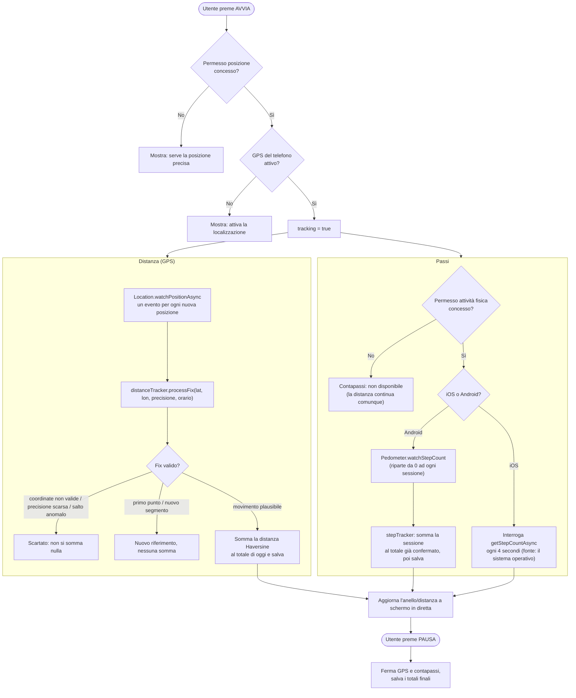
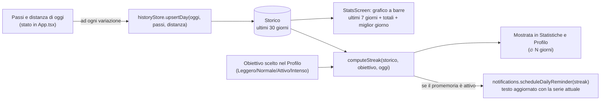
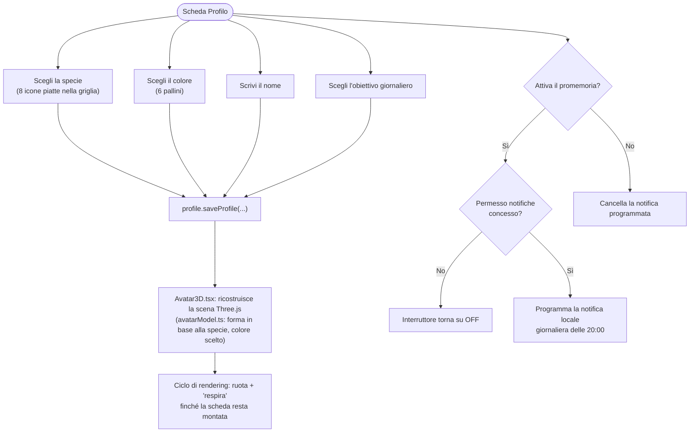

# Flowchart dell'applicazione

Schema visivo di come è fatta l'app e di come scorrono i dati, utile per orientarsi nel codice
senza doverlo leggere tutto. Per la spiegazione testuale dettagliata di ciascun pezzo vedi
[`COME-FUNZIONA.md`](./COME-FUNZIONA.md); questo file mostra solo i flussi.

## 1. Architettura generale

Chi dipende da cosa, ad alto livello. `App.tsx` è l'unico punto che tiene lo stato e lo passa
alle tre schede; le schede non parlano mai direttamente tra loro.

## 2. Avvio dell'app

Cosa succede tra l'apertura dell'app e la prima schermata utile.

## 3. AVVIA / PAUSA — tracciamento di oggi

Il cuore dell'app: cosa succede quando si preme AVVIA, e come si dividono GPS e contapassi.

## 4. Statistiche, obiettivo e serie ("streak")

Come i numeri di "Oggi" diventano lo storico e la serie mostrata in Statistiche/Profilo.

## 5. Profilo: avatar 3D, obiettivo, promemoria

