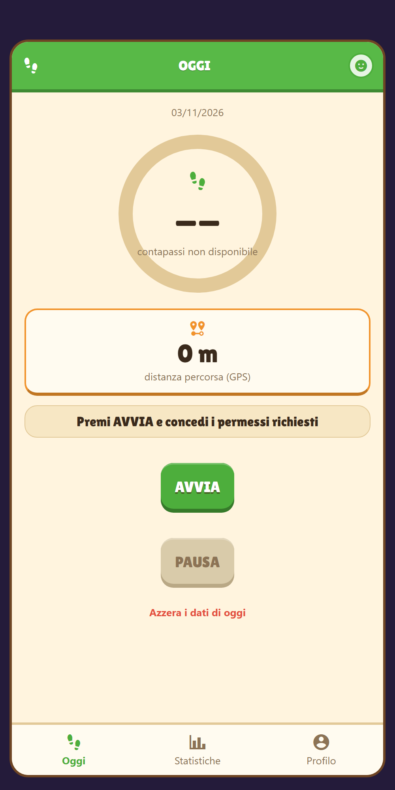
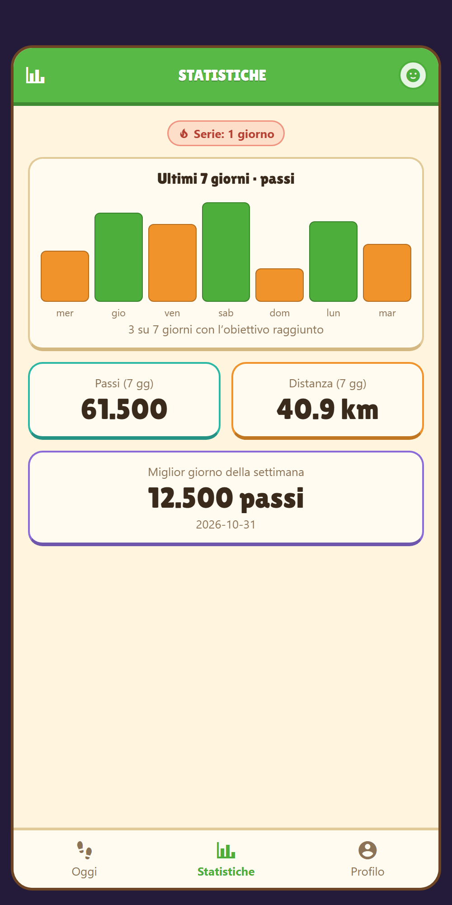

# Distanza giornaliera

App Android e iPhone che misura **distanza percorsa** e **passi** della giornata, con statistiche,
obiettivi giornalieri, serie ("streak") stile Duolingo e un promemoria quotidiano. Scritta in
React Native/Expo: stesso codice per entrambi i sistemi, provabile subito con **Expo Go** o
installabile come **APK Android** già pronto (vedi [Scarica l'APK](#scarica-lapk-android)).

> Questo progetto è nato come [app Python/Kivy solo Android](python-kivy/), poi riscritto in
> Expo per girare anche su iPhone. Il motore di calcolo della distanza (`src/distanceTracker.ts`)
> è un porting 1:1, non modificato, di `python-kivy/distance_tracker.py`: stessa formula di
> Haversine, stessi filtri su precisione/rumore/salti GPS, stesso azzeramento a mezzanotte.

## Anteprima

<table>
<tr>
<td></td>
<td></td>
<td></td>
</tr>
<tr>
<td align="center">Oggi</td>
<td align="center">Statistiche</td>
<td align="center">Profilo</td>
</tr>
</table>

*(screenshot reali, presi dalla build Web dell'app con `npm run web`, non mockup disegnati a mano;
la schermata Statistiche usa dati di esempio solo per mostrare come appare con uno storico pieno)*

## Funzionalità

- **Distanza GPS di oggi** — calcolo Haversine con filtri su precisione/rumore/salti del segnale (`src/distanceTracker.ts`, invariato rispetto all'originale Python).
- **Contapassi vero** — letto dal sensore passi del telefono (`expo-sensors`), non stimato dal GPS: funziona anche al chiuso. Vedi [`COME-FUNZIONA.md`](./COME-FUNZIONA.md) per i dettagli per piattaforma.
- **Statistiche** — storico degli ultimi 30 giorni, grafico a barre degli ultimi 7, totali settimanali, miglior giorno.
- **Obiettivo giornaliero e serie ("streak")** — 4 livelli di obiettivo passi (Leggero/Normale/Attivo/Intenso) e conteggio dei giorni consecutivi in cui è stato raggiunto, stile Duolingo.
- **Promemoria giornaliero** — notifica locale facoltativa alle 20:00 che ricorda di camminare e menziona la serie da non perdere, se attivata dall'utente nel Profilo.
- **Avatar personalizzabile** — icona, colore e nome, scelti liberamente nella schermata Profilo.

## Avvio rapido

Richiede [Node.js](https://nodejs.org) 20.19+ (LTS).

```bash
./start.sh        # Windows: start.bat
```

Alla prima esecuzione lo script installa le dipendenze (`npm install`), poi avvia il server Expo in modalità LAN e mostra un QR code nel terminale.

1. Installa **Expo Go** dal Play Store (Android) o dall'App Store (iPhone).
2. Il telefono e il computer devono essere sulla stessa rete Wi-Fi.
3. Scansiona il QR code: su Android dall'app Expo Go, su iPhone con l'app Fotocamera.
   - Su iPhone, Expo Go richiede un account Expo gratuito ([expo.dev/signup](https://expo.dev/signup)): accedi nel terminale quando richiesto e con lo stesso account dentro l'app.
   - Su Android non serve nessun account.
4. Tieni il terminale aperto: l'app si ricarica automaticamente a ogni modifica del codice.

Se la rete Wi-Fi blocca la connessione diretta (reti aziendali/scolastiche, telefono su rete dati), usa la modalità tunnel:

```bash
./start.sh tunnel
```

## Comandi utili

```bash
npm start           # equivalente a ./start.sh senza le scelte guidate
npm test            # esegue i test del motore di calcolo (Jest)
npm run typecheck   # controllo dei tipi TypeScript
```

> Nota tecnica: questi script invocano i tool (`expo`, `jest`, `tsc`) tramite
> `node node_modules/<pacchetto>/bin/...` invece dei comandi diretti (`npx expo`, `npx jest`...).
> Su Windows gli shim `.cmd` generati da npm in `node_modules\.bin` possono rompersi se il percorso
> del progetto contiene certi caratteri speciali (es. `^`): vedi [`COME-FUNZIONA.md`](./COME-FUNZIONA.md)
> per i dettagli.

## Struttura

- `App.tsx` — orchestratore: carica i dati salvati, gestisce GPS/contapassi/notifiche e mostra la scheda attiva tra le tre di seguito, con una barra di navigazione in basso.
- `src/screens/TodayScreen.tsx` — scheda **Oggi**: anello dei passi, distanza del giorno, AVVIA/PAUSA/azzeramento.
- `src/screens/StatsScreen.tsx` — scheda **Statistiche**: grafico a barre degli ultimi 7 giorni, totali, miglior giorno, serie attuale.
- `src/screens/ProfileScreen.tsx` — scheda **Profilo**: avatar personalizzabile, obiettivo giornaliero, interruttore del promemoria.
- `src/distanceTracker.ts` — calcolo Haversine, controlli di qualità, persistenza con `@react-native-async-storage/async-storage`. **Non modificato** rispetto alla versione originale.
- `src/distanceTracker.test.ts` — porting dei test di `python-kivy/tests/test_distance_tracker.py`.
- `src/stepTracker.ts` — somma e persiste i passi di oggi letti dal sensore (su Android, dove il sensore riparte da 0 ad ogni sessione di ascolto; vedi `COME-FUNZIONA.md`).
- `src/historyStore.ts` — storico giornaliero (max 30 giorni), calcolo della serie di giorni consecutivi con obiettivo raggiunto.
- `src/profile.ts` — persistenza di avatar, obiettivo giornaliero e preferenza notifiche.
- `src/notifications.ts` — programma/cancella il promemoria locale giornaliero (`expo-notifications`).
- `src/theme.ts` / `src/ui.tsx` — stile grafico "chunky" (pannello crema, font Lilita One, bottoni "3D", anello di progresso, grafico a barre, tab bar) e componenti riusabili.
- `start.bat` / `start.sh` — avviano il server Expo e mostrano il QR code per Expo Go.
- `scripts/expo-cli.js` — avvia la CLI di Expo evitando gli shim `.cmd` rotti su Windows e disabilita il menu sviluppatore che si apre scuotendo il telefono (vedi `COME-FUNZIONA.md`).
- `eas.json` — profili di build EAS (vedi sotto).

## Permessi

- **Posizione** (per la distanza): Android `ACCESS_FINE_LOCATION`/`ACCESS_COARSE_LOCATION`, iOS `NSLocationWhenInUseUsageDescription`. La misurazione funziona solo con l'app aperta in primo piano.
- **Attività fisica/motion** (per il contapassi): Android `ACTIVITY_RECOGNITION`, iOS `NSMotionUsageDescription`. Se il permesso viene negato, il contapassi mostra "non disponibile" ma la distanza GPS continua a funzionare normalmente.
- **Notifiche** (per il promemoria, facoltativo): richiesto solo se l'interruttore in Profilo viene attivato. Sono notifiche locali, programmate sul telefono: non c'è nessun server dietro.

Tutti configurati in `app.json`.

## Scarica l'APK Android

Chi non vuole installare Expo Go può scaricare un APK già pronto dalla pagina delle
[**Release su GitHub**](https://github.com/Leo-Galli/distanza-giornaliera/releases/latest)
e installarlo direttamente sul telefono (serve consentire "installa da sorgenti sconosciute" la
prima volta, come per qualunque APK fuori dal Play Store).

L'APK è generato con [EAS Build](https://docs.expo.dev/build/introduction/) (il servizio cloud di
Expo per compilare build native senza Android Studio/Xcode in locale), con il profilo `production`
di `eas.json` configurato per produrre un `.apk` installabile direttamente (non un `.aab`, che è
pensato solo per il Play Store). Per generarne uno nuovo dopo aver modificato il codice:

```bash
npx eas-cli@latest build --platform android --profile production
```

Richiede di essere loggati con un account Expo gratuito (`npx eas-cli@latest login`), lo stesso
già usato da `start.bat`/`start.sh` per Expo Go.

## Versione originale Python/Kivy

La prima versione dell'app (solo Android, tramite Buildozer) resta disponibile, non più
mantenuta, nella cartella [`python-kivy/`](python-kivy).
